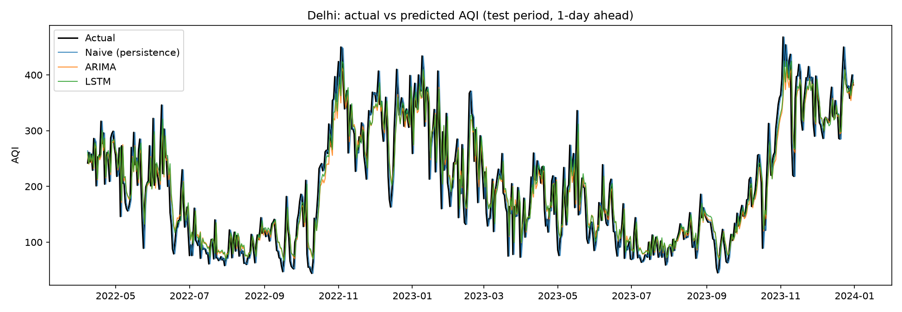

# Daily AQI Forecasting for 8 Indian Cities

Forecasting next-day Air Quality Index (AQI) for Panipat, Haldia, Guwahati, Chennai,
Patna, Ahmedabad, Delhi and Kolkata using time-series (ARIMA) and deep learning (LSTM)
models, trained on CPCB daily AQI bulletins from 2015 to 2023.

## Overview
Each city gets its own model that reads recent AQI history and predicts tomorrow's value.
Models are tested on the most recent 20% of days, which they never saw during training.
The best model per city typically predicts next-day AQI to within 11 to 31 points on average.

## Data
- CPCB daily AQI bulletins, 2015-2023, via Urban Emissions: <add link>
- Put the per-city files in a `bulletins/` folder, named like `Panipat_AQIBulletins.csv`.
- Cities: Panipat, Haldia, Guwahati, Chennai (same town/city as an IOCL group refinery);
  Patna (proxy for Barauni) and Ahmedabad (proxy for Vadodara); Delhi and Kolkata
  (reference cities, not refinery sites).

## Approach
1. **Cleaning:** gaps of up to 21 days are filled by linear interpolation. Each city is cut
   to one continuous stretch (the most recent one of at least 500 days). Filled days are
   used for training but never counted when scoring.
2. **Split:** chronological, first 80% of days for training, last 20% for testing.
3. **Models:**
   - **ARIMA:** differencing chosen by the ADF stationarity test, (p, q) by lowest AIC
     over a 0-3 grid, fitted on training data only.
   - **LSTM:** reads the previous 7 days (AQI level and day-to-day change) and predicts
     the next day's change, which is added to today's AQI.
4. **Evaluation:** MAE (average miss, in AQI points) and RMSE (penalizes large misses).
   A "tomorrow = today" persistence forecast is included as a reference point.

## Forecast results

Best model per city, chosen by test RMSE:

| City | Best model | MAE | RMSE | Test days |
|------|-----------|-----|------|-----------|
| Panipat | LSTM | 16.30 | 34.09 | 134 |
| Haldia | LSTM | 11.17 | 16.50 | 222 |
| Guwahati | ARIMA | 26.82 | 38.42 | 355 |
| Chennai | ARIMA | 12.56 | 18.94 | 633 |
| Patna | ARIMA | 23.16 | 31.36 | 605 |
| Ahmedabad | LSTM | 15.70 | 22.87 | 448 |
| Delhi | ARIMA | 31.18 | 41.25 | 633 |
| Kolkata | ARIMA | 20.59 | 29.52 | 417 |

Forecast plots (actual vs predicted over the test period) are in `results_recent/`, one
per city, for example:




<details>
<summary>Full results, including the persistence reference (RMSE)</summary>

| City | Persistence | ARIMA | LSTM |
|------|-------------|-------|------|
| Panipat | 35.10 | 34.99 | 34.09 |
| Haldia | 16.76 | 16.74 | 16.50 |
| Guwahati | 39.91 | 38.42 | 39.88 |
| Chennai | 19.91 | 18.94 | 19.32 |
| Patna | 33.17 | 31.36 | 31.72 |
| Ahmedabad | 24.88 | 22.98 | 22.87 |
| Delhi | 43.32 | 41.25 | 41.35 |
| Kolkata | 30.57 | 29.52 | 29.74 |

All MAE and RMSE values are in `results_recent/metrics.csv`.
</details>

## What the forecasts show
- **Trends and seasons are tracked well.** The forecasts follow the winter rise and monsoon
  low in every city.
- **Sudden spikes are the weak spot.** Short bursts (Diwali-season peaks, stubble-burning
  episodes) are underpredicted or arrive a day late, because AQI history alone cannot
  signal them in advance.
- **Error scales with pollution level.** Cleaner coastal cities (Haldia, Chennai) have
  the smallest errors, while Delhi and Guwahati, with higher and more volatile AQI, have
  the largest.
- **ARIMA and LSTM perform similarly.** ARIMA was best in 5 cities and LSTM in 3, mostly
  by small margins, so model choice matters less than the data quality in each city.
- The 10 largest errors per city are listed in `results_recent/<City>_top10_errors.csv`.

## How to run
```bash
git clone https://github.com/aarushikansal/aqi_forecast.git
cd aqi_forecast
pip install -r requirements.txt
python aqi_forecast_recent.py
```
Outputs are written to `results_recent/`. TensorFlow is only needed for the LSTM; without
it the script still runs ARIMA and the reference forecast.
Tested on Python <your version, from `python --version`>.

## Limitations and future work
- Only past AQI is used. Adding weather, season, and fire or festival indicators should help
  with spikes.
- Forecasts are one day ahead; longer horizons would be less accurate.
- One chronological split per city. Panipat (134 test days) and Haldia (222) have short
  test sets, so their results are noisier.
- Proxy cities stand in for refinery sites that are not in the source data.