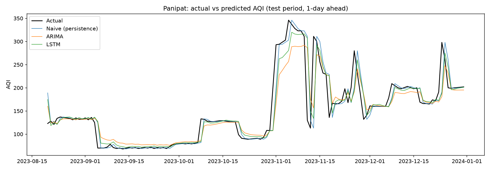

# AQI Forecasting: Baseline vs ARIMA vs LSTM

One-day-ahead forecasting of daily Air Quality Index (AQI) for 8 Indian cities,
testing whether ARIMA and an LSTM neural network can beat the simplest guess:
"tomorrow = today".

## Data
- CPCB daily AQI bulletins, 2015-2023, via Urban Emissions: <add link>
- Put the per-city files in a `bulletins/` folder, named like `Panipat_AQIBulletins.csv`.
- Cities: Panipat, Haldia, Guwahati, Chennai (same town/city as an IOCL group refinery);
  Patna (proxy for Barauni), Ahmedabad (proxy for Vadodara);
  Delhi and Kolkata (reference cities, not refinery sites).

## Method
1. **Cleaning:** gaps of up to 21 days are filled by linear interpolation. Each city is cut
   to one continuous stretch (the most recent one of at least 500 days). Filled days are used
   for training but never counted when scoring.
2. **Split:** chronological, first 80% of days to train, last 20% to test.
3. **Baseline:** tomorrow's AQI = today's AQI.
4. **ARIMA:** differencing order chosen by the ADF stationarity test, (p, q) chosen by
   lowest AIC over a 0-3 grid, fitted on the training period only.
5. **LSTM:** reads the previous 7 days (AQI level and day-to-day change) and predicts the
   next day's change, which is added to today's AQI. Scalers use training data only.
6. **Metrics:** MAE and RMSE on the test period.

## Results (RMSE)

| City | Naive | ARIMA | LSTM | Best |
|------|-------|-------|------|------|
| ...  | ...   | ...   | ...  | ...  |

Full tables are in `results_recent/metrics.csv`. Forecast plots are in
`results_recent/<City>_forecast.png`. The 10 largest errors per city are in
`results_recent/<City>_top10_errors.csv`.



## Key finding
AQI is strongly autocorrelated, so the naive baseline is hard to beat.
<Summarize: which cities, if any, ARIMA or LSTM beat it in, and by roughly how much.>

## How to run
```bash
git clone https://github.com/aarushikansal/aqi_forecast.git
cd aqi_forecast
pip install -r requirements.txt
python aqi_forecast_recent.py
```
Outputs go to `results_recent/`. TensorFlow is only needed for the LSTM. Without it the
script skips the LSTM and still runs the baseline and ARIMA.
Tested on Python <your version, from `python --version`>.

## Limitations
- Only past AQI is used (no weather, season or events like Diwali or stubble burning).
- One chronological split per city; results may differ on other periods.
- Proxy cities are stand-ins, not the refinery locations themselves.
- Interpolated gaps affect training data.